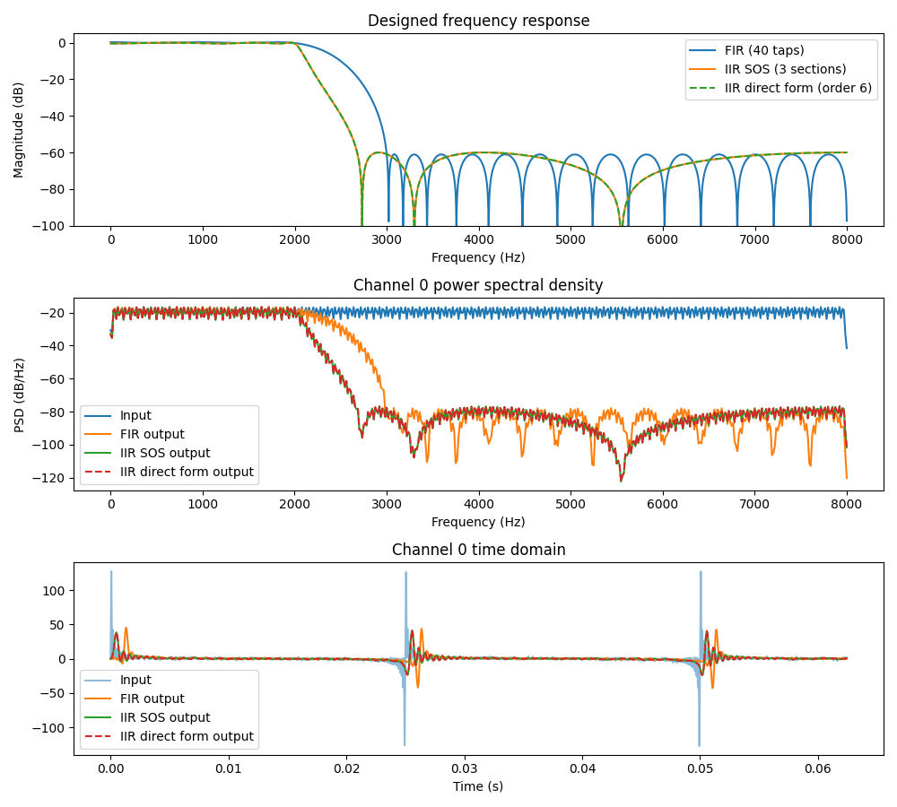

# DSP Toolbox



This repository contains a collection of tools that aid in the development and
design of signal processing algorithms. There are filter implementations in C
that allow FIR/IIR filters to be calculated against floats, doubles and
integers. There are also waveform generation tools to make generating test data
simpler.

There are C++ wrappers to make interaction in a C++ environment smoother, this
allows wrapping of different types more clean. It potentially allows for better
abstractions to be made available.

Although there is a python bindings folder, these are still a work in progress.
Do not use them until more work has been done to fix these (pull requests
welcome).

# Getting started

The C sources are generated from jinja2 templates and compiled into a static
library by running `make` from the root of the project:

```shell
make
```

This generates the sources and builds `build/libdsptoolbox.a`. Link it after
your own sources, with `-lm` if you use any of the modules that need the maths
library. Running `make` again regenerates the sources when a template, the
generator or the generation options change, and only recompiles what changed.
`make shared` builds the same modules as a shared library,
`build/libdsptoolbox.so`, from position independent copies of the objects.
`make examples` also builds every C and C++ example against the library, and
`make clean` removes the `build/` directory.

The build is set up with variables on the command line:

| Variable | Default | Description |
| :--- | :--- | :--- |
| `GEN_ARGS` | *(none)* | Options for `scripts/generate_sources.py`, see `python scripts/generate_sources.py --help` and the [C API documentation](API_REFERENCE.md#generation-options-copy-functions) |
| `CC`, `AR`, `CFLAGS` | `cc`, `ar`, `-Wall -O3` | The compiler, archiver and flags, e.g. for cross compiling |
| `JSON` | `1` | Set to `0` to leave out the JSON filter loading and cJSON, which need the C standard library |
| `BUILD_DIR` | `build` | Where the objects and libraries go |
| `LDFLAGS` | *(none)* | Extra flags for linking the shared library |
| `SANITIZE` | `0` | Set to `1` to build the library and examples with the address and undefined behaviour sanitizers, see below |

For example, for a Cortex-M4F without a C standard library, with a const FFT
twiddle table and no maths library in the FFT:

```shell
make CC=arm-none-eabi-gcc AR=arm-none-eabi-ar \
     CFLAGS="-O2 -mcpu=cortex-m4 -mfpu=fpv4-sp-d16 -mfloat-abi=hard" \
     GEN_ARGS="--no-stdlib --fft-twiddle-table 1024 --fft-table-only" JSON=0
```

The generated sources are written into the source tree, next to the
templates' other outputs, so they are shared by every `BUILD_DIR`. Changing
`GEN_ARGS` regenerates them for all builds. Changing the compiler or
`CFLAGS` rebuilds the library.

To check for memory errors and undefined behaviour, build and run the examples
with the sanitizers. The first error stops the program with a non-zero exit
status:

```shell
make SANITIZE=1 examples
```

GCC needs its sanitizer runtimes installed (`libasan` and `libubsan` on
Fedora). Clang has its own, and is used with `CC` and `CXX`, which the C and
C++ examples use respectively:

```shell
make SANITIZE=1 CC=clang CXX=clang++ examples
```

Run a normal `make` afterwards to rebuild the library without them.

# API documentation

- [C functionality](API_REFERENCE.md)
- [C++ bindings](/cpp_bindings/CPP_API_REFERENCE.md)

# C++ examples

Examples using the C++ bindings are in `cpp_bindings/examples/`. Build each
example with `make` from inside its folder, which builds the library first if
needed:

| Example | Build | Description |
| :--- | :--- | :--- |
| `decimation` | `make decimation` | Benchmarks FIR decimation of 288 channels on a single thread, comparing two memory layouts: one reused chunk buffer (path A) and a buffer per channel (path B). `make verify` checks that both paths give identical output. |
| `multithread` | `make multithread` | Benchmarks FIR, IIR (SOS) and IIR (direct form) filters designed to the same lowpass specification, comparing 1 thread against `N_THREADS` (default 4) with the channels split evenly across the threads. Checks that the multi-threaded output is identical. |
| `spectrum_test` | `make spectrum` | Generates a test spectrum and prints its power. |
| `waveform_gen` | `make spectrum` | Generates multi-channel waveforms to a CSV file, plotted with `plot_waveform_gen.py`. |

The `decimation` and `multithread` examples also have a `run_all` target that
runs the benchmark and then plots the results. They generate a large input
data file (around 230 MB) in their `results/` folder on the first run, and
reuse it afterwards unless built with `REGEN_INPUT_FILE=true`. The filter
designs are stored in JSON files next to each example, and can be regenerated
with the `filter_design.py` script in that folder.

# cJSON

This project uses the cJSON library for parsing filters exported in JSON format.
The license for this project doesn't apply to the files in cjson/, the original
license from that project is included in that folder to avoid confusion.

# jinja2 templates

To make maintenance of the C implementations more easy, a lot of code is
generated from jinja2 templates. This allows support for multiple C types
without having to manually copy-paste similarities between different C functions
that just need to handle different types. The C++ wrapper traits, which map each
type to its C structs and functions, are generated from the same templates
directory into `cpp_bindings/cpp_traits_<module>.h`.

# Octave

There are a variety of Octave/Matlab scripts dotted around for visualising data
and in some cases generating filter coefficients and structures. These aren't
strictly necessary to run the code examples, but it is a nice to have for DSP
development in general.

# Python packages

This project uses python scripts for generating filter coefficients/structures,
as well as interpreting results. As a result there are a few dependencies that
you will need:

- jinja2
- matplotlib
- numpy
- pandas
- scipy
